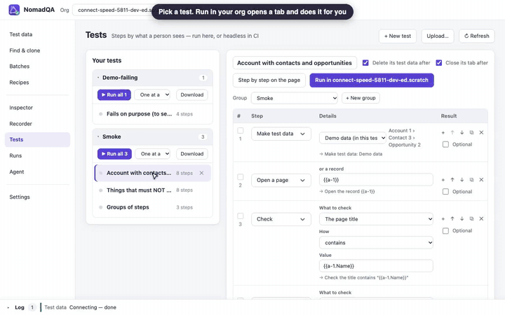

<h1 align="center">NomadQA</h1>

<p align="center"><a href="https://faridmasjedi.github.io/nomadqa/"><b>📖 Website and documentation: faridmasjedi.github.io/nomadqa</b></a></p>

<p align="center">Testing for Salesforce, in plain words.<br>A Chrome/Edge extension to point, record and run tests — and a headless runner for CI.<br><b>No packages. No build step.</b></p>

<p align="center"></p>

<p align="center"><a href="docs/media/video/00-tour.mp4"><b>▶ Watch the tour</b></a></p>

## What it does

- **Point** at anything on a Salesforce page and add a check or a click to a test — [Inspector](docs/inspector.md)
- **Record** what you do once; it becomes steps — [Recorder](docs/recorder.md)
- **Write** steps in plain words and **run** them in a tab of your org — [Tests](docs/tests.md)
- **Make test data** that looks real, with its links — [Test data](docs/test-data.md)
- **Ask an AI** for a first draft — [Agent](docs/agent.md)
- **Run anywhere**: the same tests, headless, in any CI — [CI and secrets](docs/ci.md)

Steps name things the way a person sees them (buttons by what they say, fields by their label), so they survive Salesforce's releases.

## Download

**[nomadqa-extension.zip](https://faridmasjedi.github.io/nomadqa/download/nomadqa-extension.zip)** (Chrome, Edge) · **[nomadqa-runner.zip](https://faridmasjedi.github.io/nomadqa/download/nomadqa-runner.zip)** (CI) · [all versions](CHANGELOG.md) · [Releases](https://github.com/faridmasjedi/nomadqa/releases)

## Try it

1. Open `chrome://extensions` (or `edge://extensions`), turn on **Developer mode**, **Load unpacked**, and choose the [`extension`](extension/) folder.
2. Log in to a sandbox or scratch org in that browser and click the **NomadQA** tab on the page's right edge.
3. Tests › **Upload…** › a file from [`examples/`](examples/) › **Run**.

## Use it in your repository

1. Download **`nomadqa-runner.zip`**, unzip it in your repository (it makes a `nomadqa` folder) and commit it.
2. Put your tests in `tests/nomadqa/` (Tests › **Download** saves them) and the automation user's SFDX auth URL — or username and password — in secrets.
3. Run `node nomadqa/runner/run.mjs tests/nomadqa --out nomadqa-reports` in your pipeline and upload the folder.

How a QA creates the tests as an automation user, a ready GitHub Actions file with one job per user, secrets in GitHub, AWS and Google Cloud, other CI, and keeping and debugging the reports: **[CI, secrets and reports](docs/ci.md)**.

## Run it without anyone watching

```sh
node runner/run.mjs examples/01-open-pages.nomadqa.json --org my-sandbox   # with the Salesforce CLI
node runner/run.mjs tests/nomadqa                  # logins from a .env file (SF_AUTH_URL, SF_USERNAME + SF_PASSWORD…)
```

Put the logins in a `.env` file next to where you run it (never commit it); see [`.env.example`](.env.example).

Node 22 and Chrome, nothing to install. You get `report.html`, JUnit and a picture of each failed step. For GitHub Actions, secrets, Google Cloud, AWS and keeping reports, see **[CI, secrets and reports](docs/ci.md)** and **[Run anywhere](RUN-ANYWHERE.md)**.

## Safe by default

Every write to an org asks you to type the org's name first · Setup is read-only · nothing heavy runs until you click · passwords are never recorded.

## Learn more

[Download](docs/download.md) · [Versions](CHANGELOG.md) · [Get started](docs/getting-started.md) · [Examples](docs/examples.md) · [Step reference](docs/steps.md) · [Reports](docs/reports.md) · [Videos](docs/videos.md)

## Develop

```sh
npm test         # unit tests
npm run pack     # nomadqa-extension.zip
npm run site     # the website → site/
```

`extension/` is the extension · `runner/` the headless runner · `examples/` ready tests · `docs/` the website.
