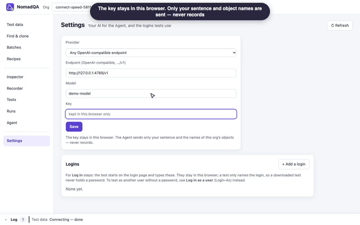

# Agent

Say what to test, in your own words. Your own AI writes the steps; NomadQA checks every one; you review and run.

<video src="media/video/07-agent.mp4" controls muted preload="metadata" poster="media/poster/07-agent.jpg"></video>

> The video uses a **stand-in AI** on the same computer that answers with a prepared test, so it can be shown without anyone's key. With your own AI it writes the steps from your sentence.

## Connect your AI

Settings › **Provider**: Anthropic (Claude), OpenAI, OpenRouter, or **any OpenAI-compatible endpoint** (a local model works; the key is optional there). Give the model name and the key.

- The key stays in this browser only; **Forget the key** removes it.
- The Agent sends **only your sentence and the names of the org's objects** — never records.

## Use it

1. Agent › type what to test, e.g. *Make an account in Energy, open it, add a contact Robin Tester, and check the contact was created.*
2. **Write the steps.**
3. NomadQA checks every step with the same rules as the Tests screen. A step it does not understand is shown in red and the count says *N step(s) to fix* — **Save and run** stays off until every step is valid.
4. **Save as a test** (then edit it in Tests like any other) or **Save and run in …**.

## What it can and cannot do

- It writes the same steps you would: data, open, click, type, choose, search, check, query. The AI never runs anything; only you do, after reviewing.
- It does not see your records, so it works from labels it can guess. Check names and values before you run.
- The result is an ordinary test: you can edit it, group it, download it and run it in CI.
