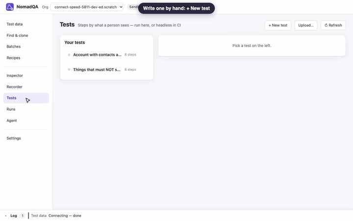

# Create tests

A test is a list of steps that name things the way a person sees them. You can **point** at the page (Inspector), **record** what you do (Recorder), **write** it by hand, or **ask** an AI (Agent). Pick a tab.

## Ways to create

<video src="media/video/03-write-and-organize-tests.mp4" controls muted preload="metadata" poster="media/poster/03-write-and-organize-tests.jpg"></video>

| # | Way | Where | Good for |
| --- | --- | --- | --- |
| 1 | **Write it by hand** | Tests › **+ New test**, **+ Step** | full control |
| 2 | **Point and pick** | [Inspector](inspector.md) › **Add to a test** › **Open in Tests** | checks you can see |
| 3 | **Record it** | [Recorder](recorder.md) › **Save as a test** | a path you walk |
| 4 | **Ask the Agent** | Agent: say what to test; your AI (Settings) writes the steps, NomadQA checks every step | a first draft |
| 5 | **Upload a file** | Tests › **Upload…**: a `*.nomadqa.json` test, a `*.nomadqa-group.json` group file (a test group), or a JUnit report NomadQA wrote | sharing, CI |
| 6 | **Copy a step** | **⧉** copies a step or step group (also to the clipboard as JSON); **Paste** puts it in any test or step group | reuse |
| 7 | **Start from an example** | [Examples](examples.md) | learning |

> The Agent sends only your sentence and the org's object names to the AI.

### Write it by hand

Choose the step kind, fill its boxes, and read the sentence under it. [All steps →](steps.md)

