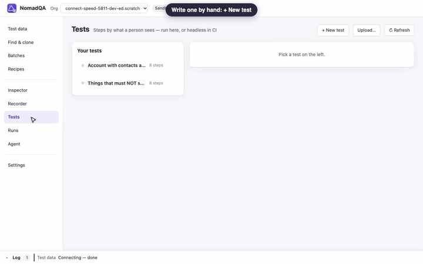
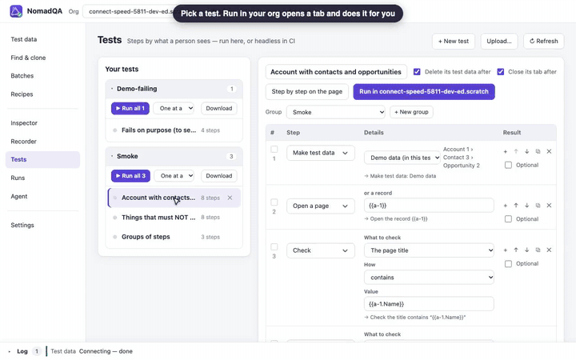

# Get started

<video src="media/video/00-tour.mp4" controls muted preload="metadata" poster="media/tour-poster.png"></video>

You need Chrome or Edge, and a Salesforce org you may test in (a sandbox or scratch org).

## 1 · Install the extension

1. Open `chrome://extensions` (or `edge://extensions`) and turn on **Developer mode**.
2. Click **Load unpacked** and choose the `extension` folder of the repository — or unzip `nomadqa-extension.zip`.
3. Log in to your org in the same browser, then click the **NomadQA** tab on the right edge of any Salesforce page.

NomadQA uses the browser's own Salesforce session, like Salesforce Inspector. Nothing is sent anywhere but to your org.

> Every change to an org asks you to type the org's name first. Use a sandbox or a scratch org.

## 2 · Your first test, three ways

Pick the one that suits you — they all end in the same list of steps.

| Way | How | Best when |
| --- | --- | --- |
| **Point** | Inspector › **Inspect it**, click things, **Add to a test** | you know what to check |
| **Record** | Recorder › **Record in …**, use Salesforce, **Save as a test** | you know the path |
| **Write** | Tests › **+ New test**, **+ Step** | you want control |



## 3 · Run it

Select the test and click **Run in …**. Each step shows ✓ or ✕, with the time. Data the test made is deleted at the end.



## 4 · Run it without anyone watching

```sh
node runner/run.mjs examples --org my-sandbox
```

Node 22 and Chrome, nothing to install. See [Run anywhere](runner.md) for logins, CI and reports.

## 5 · Use it in your repository

Download `nomadqa-runner.zip` from [Download](download.md), unzip it in your repository, put your tests in `tests/nomadqa/`, and run `node nomadqa/runner/run.mjs tests/nomadqa` in your pipeline with `SF_AUTH_URL` in a secret. The full recipes — GitHub Actions, secrets, many users, keeping the reports — are in [CI, secrets and reports](ci.md).

## Good to know

- **Refresh** on every screen opens it again, cleared; saved plans and tests stay.
- **Close its tab after** (on by default) closes the tab a test ran in when it ends.
- Passwords are never recorded; logins live in Settings and the test only names them.
