

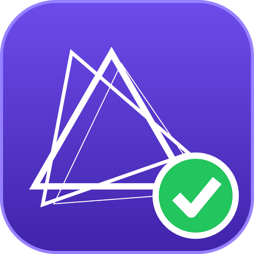
<h1>NomadQA</h1>

Testing for Salesforce, in plain words. A browser extension to point, record and run tests — and a headless runner for your CI. <b>No packages. No build step.</b>

<a class="btn" href="download.html">⬇ Download {{version}}</a><a class="btn alt" href="getting-started.html">Get started in 2 minutes</a><a class="btn alt" href="videos.html">Watch the videos</a><a class="btn alt" href="https://github.com/faridmasjedi/nomadqa">GitHub</a>

<video src="media/video/00-tour.mp4" controls muted preload="metadata" poster="media/poster/00-tour.jpg"></video>

*The NomadQA tour — [all the videos](videos.md).*

## What you can do

<h3>Point at anything</h3>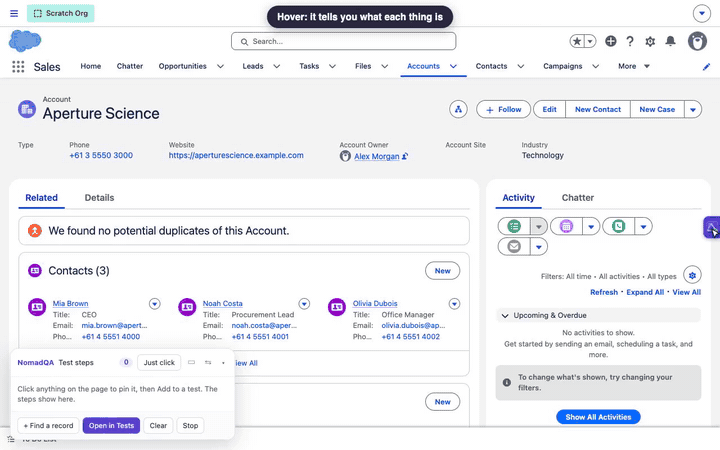
Hover to see what a thing is, pin it, and add a check or a click to your test.

<h3>Add, or Add and click</h3>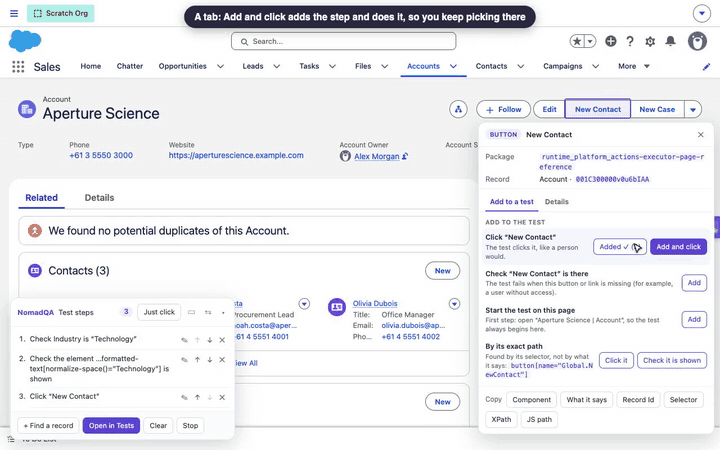
Add puts the step in; Add and click also does it, so you keep picking where you land.

<h3>Do it once</h3>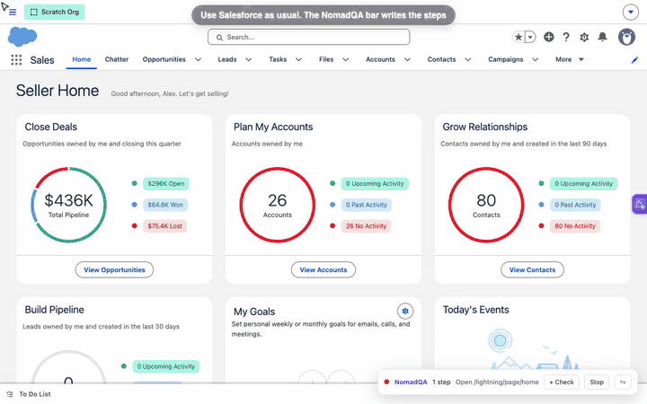
Use Salesforce as usual. Clicks, typing, lists, lookups and searches become steps.

<h3>Write it in words</h3>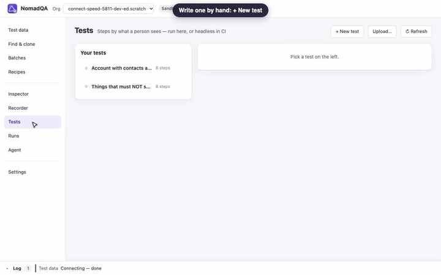
Open, click, type, choose, search, check — each step reads back as a sentence.

<h3>Keep them organized</h3>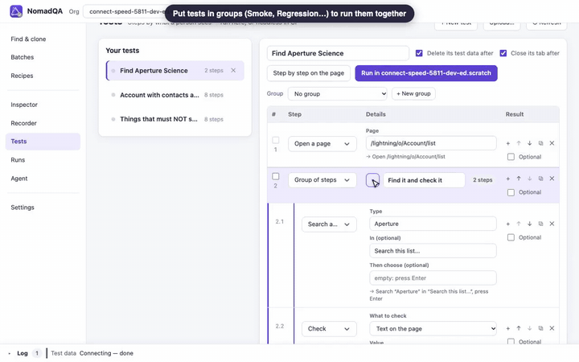
Group steps, group tests (Smoke, Regression…), copy, download, upload.

<h3>Run it for you</h3>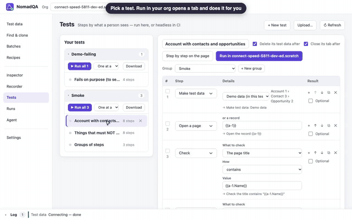
A tab of your org opens and NomadQA does the steps. One at a time, or 2–8 at once.

<h3>Fix it on the page</h3>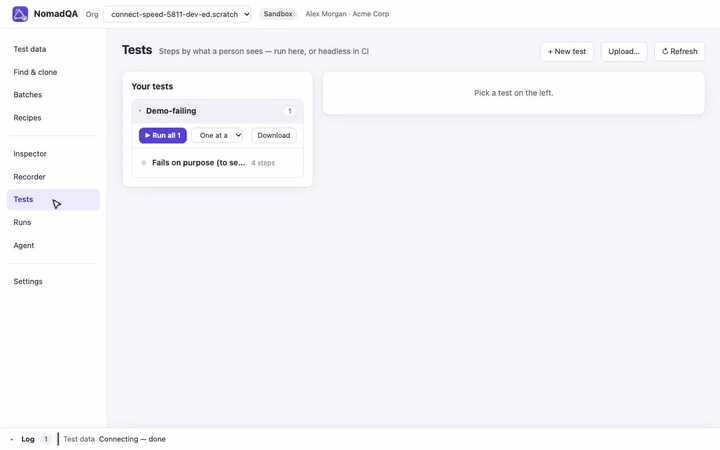
The step, what was expected, what the page had, a picture — then fix it on the real page.

<h3>Step by step</h3>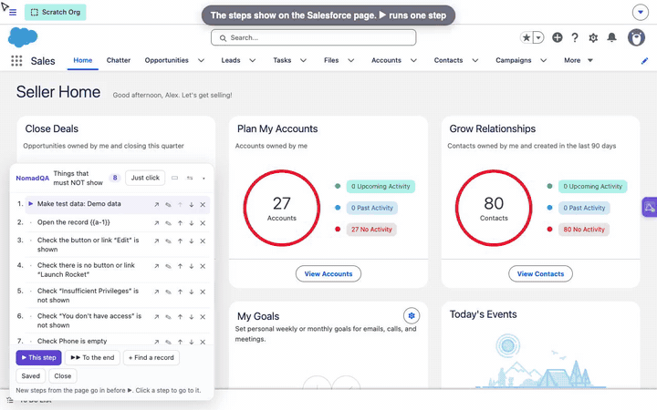
▶ one step, ▶▶ to the end; change a step and save it back to the test.

<h3>Make test data</h3>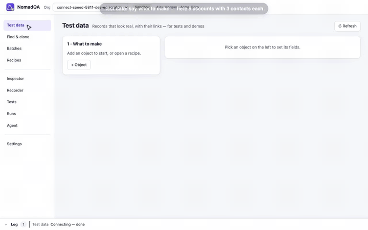
Real-looking records with their links, checked in a rolled-back transaction first.

<h3>Reports</h3>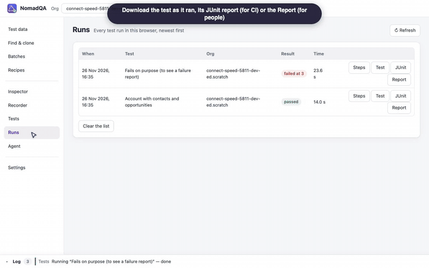
One HTML page for people, JUnit for your CI — in Runs, and from the runner.

<h3>Ask the Agent</h3>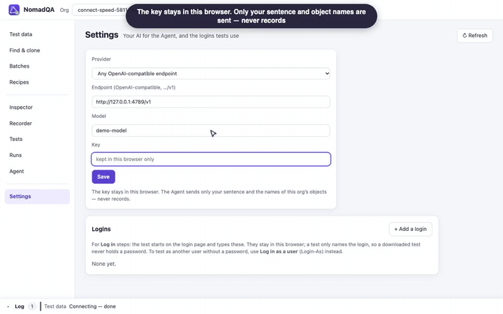
Say what to test; your AI writes the steps and NomadQA checks every one.

<h3>Run it anywhere</h3>
One command in any CI. The same engine, the same tests.

## Download

<h3>The extension</h3>
Chrome and Edge · version {{version}}

<a class="btn" href="download/nomadqa-extension.zip">⬇ nomadqa-extension.zip</a>

<h3>The runner</h3>
For CI and your computer · version {{version}}

<a class="btn" href="download/nomadqa-runner.zip">⬇ nomadqa-runner.zip</a>

<h3>What changed</h3>
Every version, with its notes.

<a class="btn alt" href="versions.html">Versions</a>

How to install them: [Download](download.md).

## Why it is different

- **Steps name what a person sees** — buttons by what they say, fields by their label. Never CSS or ids, so tests survive Salesforce's releases. (When you need an exact path, you can use one.)
- **One engine** runs your steps in the browser and in headless Chrome alike. A test that passes in the extension passes in CI.
- **Safe by default.** Every write to an org asks you to type the org's name first. Setup stays read-only for tests. Nothing heavy runs until you click.
- **No packages.** Plain JavaScript the browser loads as it is; Node 22 and Chrome for the runner.

## Where next

| I want to… | Read |
| --- | --- |
| Download it | [Download](download.md) · [Versions](versions.md) |
| Install it and run a first test | [Get started](getting-started.md) |
| Build, run, edit and use tests — every way | [Tests](tests.md) |
| Copy a test that already works | [Examples](examples.md) |
| Run tests in GitHub Actions, GitLab, Jenkins… | [Run anywhere](runner.md) |
| See where the reports are | [Reports](reports.md) |
| Let an AI write the first draft | [Agent](agent.md) |
| Look up a step | [Step reference](steps.md) |
