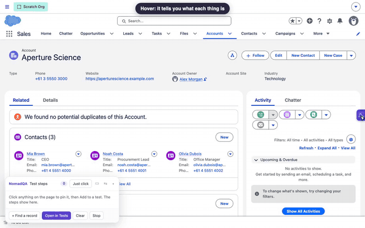
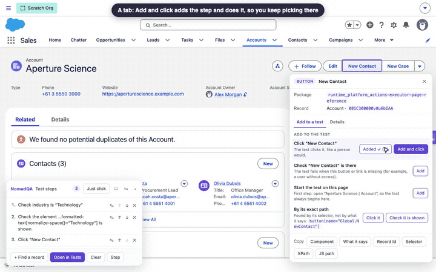
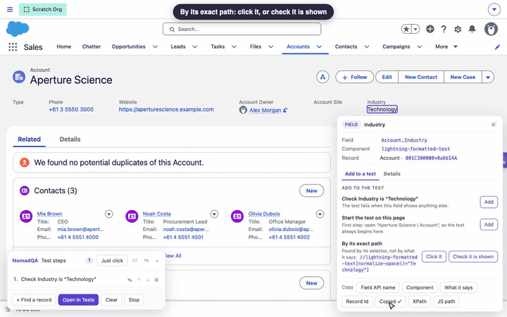

# Inspector

Point at anything on a Salesforce page: what it is, and where it comes from. Then turn it into a step.

<video src="media/video/01-inspector-to-test.mp4" controls muted preload="metadata" poster="media/tour-poster.png"></video>

*The whole journey: open NomadQA, Inspector, Inspect it, pick, Open in Tests, saved as a test.*

## Start it

- On any Salesforce page press <kbd>Alt</kbd> + <kbd>Shift</kbd> + <kbd>I</kbd>, or
- in NomadQA, **Inspector › Inspect it** (it lists every org you are logged in to, with its open tabs; **Open and inspect** for an org without one).

Hover to see. **Click to pin** it. <kbd>Esc</kbd> stops. **Just click** in the list at the bottom left lets the page work as usual (menus, tabs) without picking.

## What it tells you

| It says | Meaning |
| --- | --- |
| **Field** | the field's API name on record pages (`Account.Industry`), or its label in forms |
| **Yours** | your own Lightning web component and its folder in the project |
| **Package** | a component from an installed package |
| **Aura** | the Aura component behind older parts of the page |
| **Built from** | the components around it, nearest first, and the record of the page |

The **Details** tab shows everything: its components, the tab and section it sits in, its parent, its path, attributes and place — each with a copy button.

## Add, or Add and click

A pinned element offers the same step two ways:

- **Add** puts the step in your test. The page stays as it is.
- **Add and click** adds the step *and* does the click, so you follow a link, open a tab or a menu — and keep picking where you land.

## By its exact path

Prefer what the step says; use a path when nothing else is steady. **Click it** and **Check it is shown** use the element's selector (CSS, XPath or a JS path through Salesforce's shadow DOM). **Copy** gives you the API name, component, what it says, a record Id, a selector, XPath or JS path.

## Turn it into steps

On a pinned element, **Add to a test** offers what makes sense for it:

- **Check** its value, **Type into** it, **Click** it, check this text shows, **start on this page**.
- **Add and click** also does the click — follow a link (a related record, a tab) and keep picking there.
- **By its exact path** — click, type or check by CSS, XPath or a JS path.
- **Click, then type and choose…** for a button that opens a list (App Launcher, a list view's menu, the gear).
- **Search and choose…** on a search bar, a list's search or a lookup.
- **+ Find a record** (by name or a condition) adds "find it" and "open it", and opens it now.

The list at the bottom shows the steps picked so far. Change (✎), move or remove them. **⇆** moves the list to the other side when it covers something; **Just click** lets the page work as usual. Then **Open in Tests**: the steps arrive in Tests under *From the inspector*, where **New test from them** saves them as a test (or **Add to** a test you have open).

**Copy** gives you the field's API name, your component, what it says, a record Id, a selector, XPath or JS path.

## Setup pages

Profiles, permission sets, users and your personal settings work like any page — the Inspector reaches into the frame Setup draws them in. Setup is **read-only** for NomadQA: tests open pages, search and check there; a click on Save, Edit, Delete, New… or a tick is refused with a clear message.
