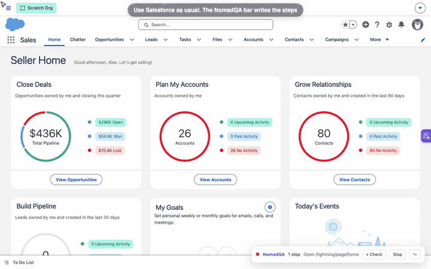

# Recorder

Do it once in Salesforce. NomadQA writes the steps, by what you see.

<video src="media/video/02-recorder-to-test.mp4" controls muted preload="metadata" poster="media/tour-poster.png"></video>

*The whole journey: open NomadQA, Recorder, record in your org, Stop, Save as a test.*

## Record

1. Recorder › **Record in …** — a new tab opens on the org.
2. Click, type and choose as usual. A bar at the bottom shows the steps as they are made.
3. **+ Check** on the bar, then a message or a value, adds a check.
4. **Stop**, then **Save as a test**.

## What it understands

- Clicks, typing, list choices, lookups.
- **Searches**: typed, then a suggestion chosen or <kbd>Enter</kbd>.
- A button that opens a list plus the item chosen in it (App Launcher → Sales, the gear → Setup) become **one** step.
- It goes on when the page loads again (another app) and in a tab the page opens (Setup from the gear). A test run follows that tab too.
- **Passwords are never recorded.**

## After recording

Back in NomadQA the **Recorder** screen lists every step as a sentence. **Save as a test** puts it in Tests (or **Discard**). The test is an ordinary one: change a step, add a check, group steps, run it. If Salesforce changes, [fix it on the page](tests.md#fix-it-on-the-page).
