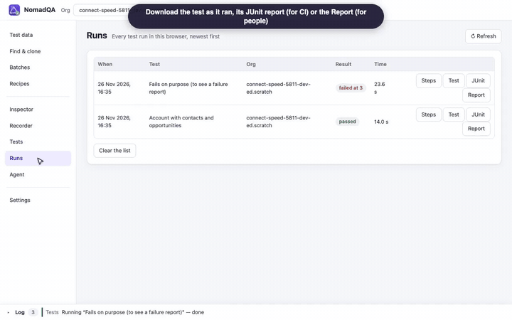
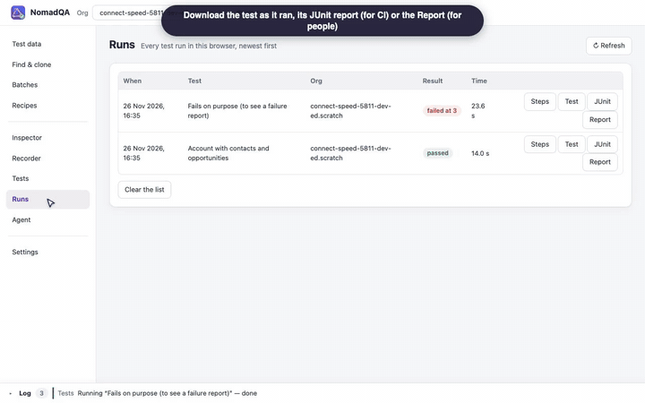

# Reports

Where to see what happened, and who it is for.

<video src="media/video/05-reports.mp4" controls muted preload="metadata" poster="media/tour-poster.png"></video>

## In NomadQA

| Where | What you see |
| --- | --- |
| **Tests** — right under a finished run | passed or failed, each step with its time; for a failure the step, **why**, what was **expected**, what the page had (**got**), Salesforce's messages, the page's address and a picture. **Report** is on this box |
| **Runs** | every run in this browser, newest first: when, test, org, result, time. **Steps** shows the steps; **Text** downloads the test as it ran; **JUnit** and **Report** download the files below. The pictures of the newest 20 runs are kept |
| **A test group's result** | after **Run all**: one box for the test group, with **Report** and **JUnit** for all its tests |

## The files

| File | For | What it is |
| --- | --- | --- |
| **Report** (`*.html`) | people — QAs, reviewers, a ticket | one page: totals, every test and step with its time, and for each failure the step, the reason, expected and got, and the picture. It opens in any browser; nothing else is needed |
| **JUnit** (`*.junit.xml`) | your CI | one per test, and one per test group. GitLab, Jenkins, Azure DevOps and GitHub show it as a list of tests. NomadQA can read its own file back: **Tests › Upload…** runs that test again |
| **Test** (`*.nomadqa.json`) | your repository | the test exactly as it ran |

## From the headless runner

The same files, written to `--out` (default `nomadqa-reports/`): `report.html`, a JUnit file per test, a picture per failed step and `summary.md` for the job page. See [Run anywhere](runner.md) for where to keep or share them.
