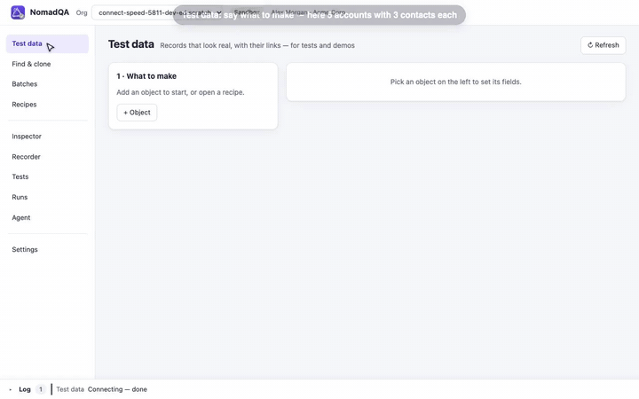
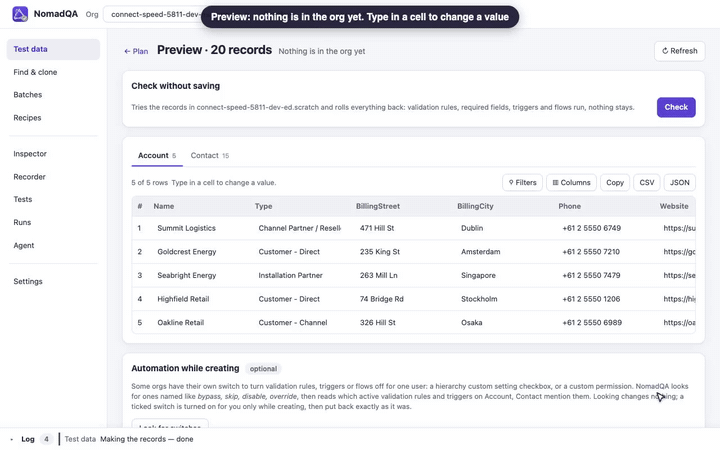
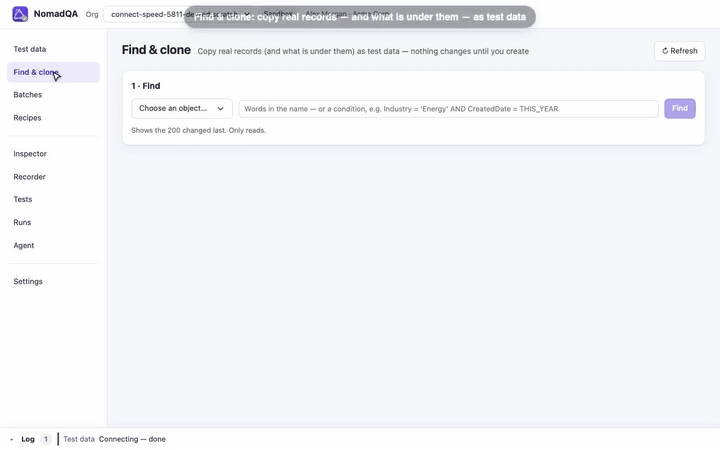
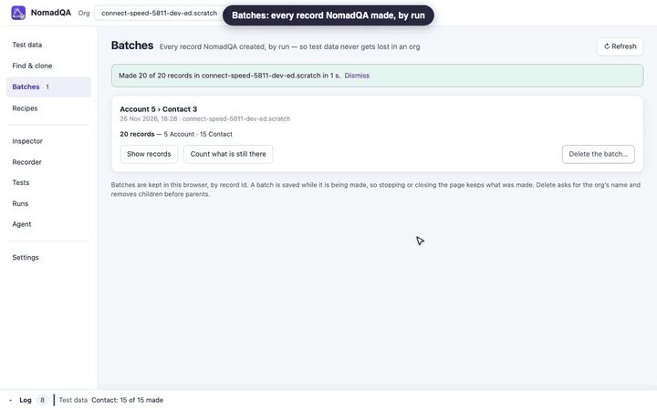

# Test data

Records that look real, with their links — for tests and demos.

<video src="media/video/06-test-data.mp4" controls muted preload="metadata" poster="media/poster/06-test-data.jpg"></video>

## Plan

Choose objects and how many, and what goes under each: 5 accounts with 3 contacts and 2 opportunities each. Parents are made first and every link is filled in. **Records above** lists the objects a top-level object can go under (its lookups, required ones first).

## Field rules

| Rule | Gives |
| --- | --- |
| **Auto** | from the field's type and name: companies, people, e-mails, phones, cities, dates, amounts, valid picklist values |
| **Leave empty** | nothing |
| **Fixed value** | the same value everywhere |
| **One of a list** / **weighted** | `Gold, Silver` · `Gold 20%, Silver 80%` |
| **Pattern** | `INV-{0000}`, `{parent.Name}`; tick **with random added** to put a made-up value after it |
| **Range** / **Days from today** | numbers, dates |
| **Records found by a query** | a lookup to existing records |

E-mails and websites always use `example.com`.

## Check without saving

The records are tried in the org inside one Apex transaction that is **rolled back**: validation rules, required fields, triggers and flows run, nothing stays. What would fail is listed with Salesforce's own message; leave those out or change the rules.

## Use it

- **Create in the org** — after typing its name.
- **CSV** files per object.
- An `@IsTest` **test data factory** class.
- A **recipe** to make the same kind of data again (Recipes).
- In a test: the **Make test data** step — records are `{{a-1}}`, `{{a-1.Name}}`, and are deleted after the test.

## Find & clone

Copy **real records — and what is under them — as test data**. Nothing changes in the org until you create.

1. **Find.** Choose an object, then type words in the name — or a condition such as `Industry = 'Energy' AND CreatedDate = THIS_YEAR` — and press **Find**. It only reads, and shows the 200 changed last.
2. **Pick** the records to copy (**Pick all**, **None**). The table has Filters, Columns, Copy, CSV and JSON, like every table in NomadQA.
3. **Clone.** Choose **the records under them** (for example *Contact · AccountId*): they are copied one level down and linked to the new parent. Choose **Copies of each** (1 to 50) and, if you like, a **pattern for the names**, optionally with the copied value added (`NomadQA clone Aperture Science`), so the copies are easy to find and delete. Every writable field is copied except those that must be unique.
4. **Preview.** The copies and what is under them appear as a table, like a plan's: type in a cell to change a value. **Check** tries them in the org and rolls everything back: what would fail is listed with Salesforce's own message. An org's **duplicate rule** can stop copies; leave those out, or tick **Save even when a duplicate rule matches**.
5. **Create** (you type the org's name first). The records are kept as a **batch**: **Batches** deletes them, children first. The preview offers the same ways to use them as a plan: CSV files, an `@IsTest` factory class, a recipe.

Cloning into **another org** leaves out fields it lacks, and links to records of the first org.

## Batches

Every record NomadQA created, by run, saved while it is made (**Stop** keeps what was made). Show records per object (filters, columns, CSV/JSON), count what is still there, and delete a batch (children first).

## Automation switch

The org's own bypass — a hierarchy custom setting or a custom permission named like "bypass" — is found, with the validation rules and triggers that check it, turned on for you only while creating, then put back exactly as it was. NomadQA never changes automation itself.
