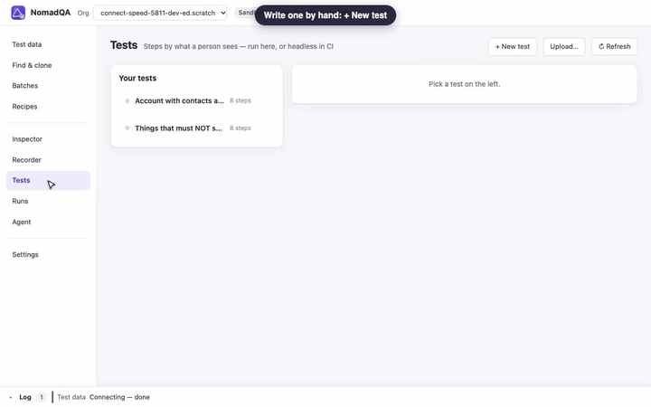
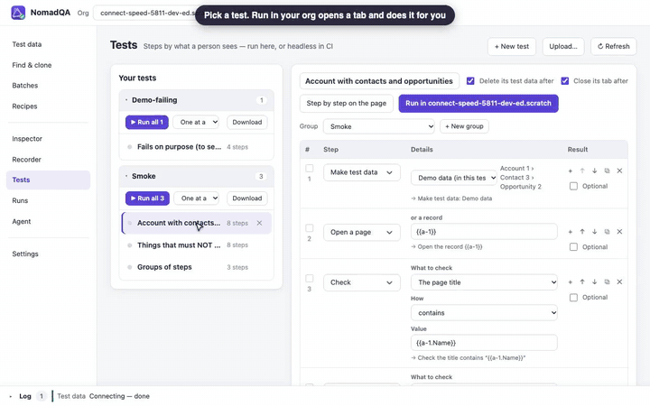
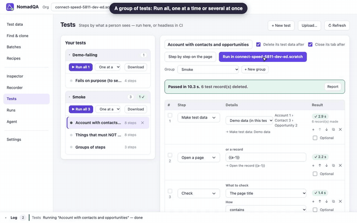
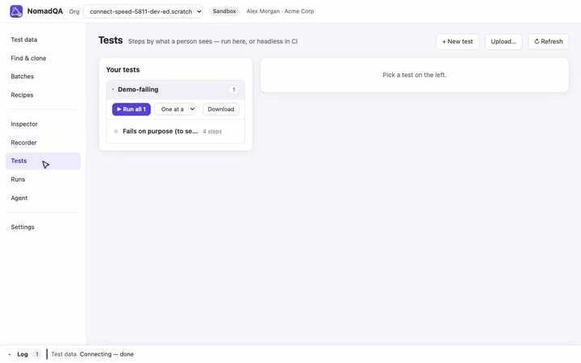
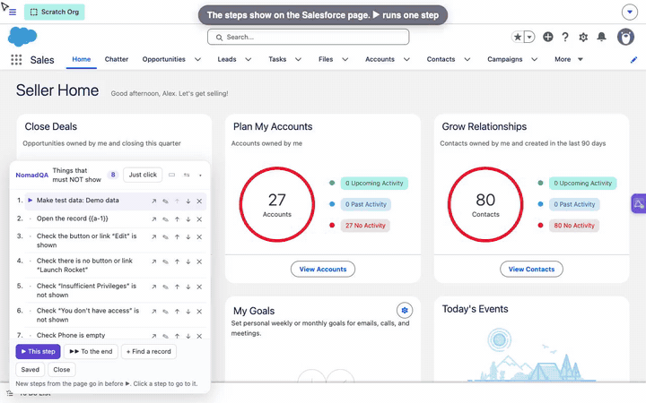
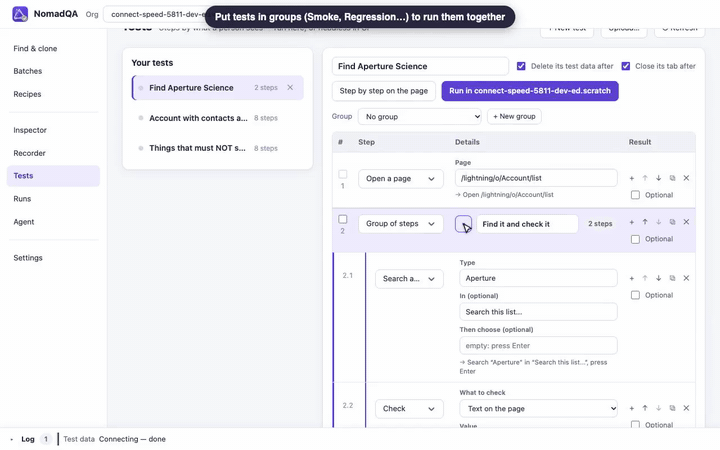
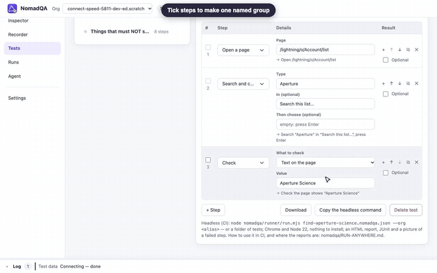
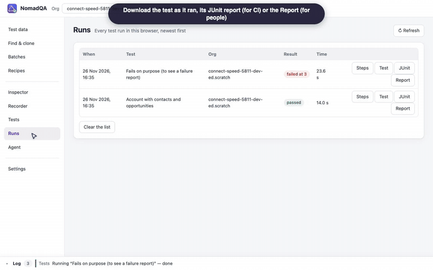
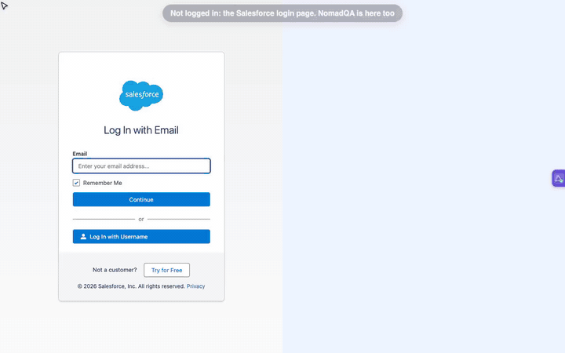
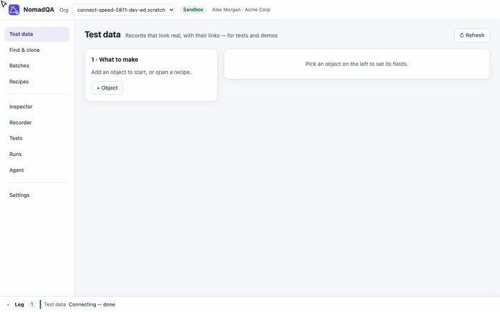

# Tests

A test is a list of steps. (Words that mean more than one thing — *group*, *login* — are explained on [Words](words.md).) Steps name things the way a person sees them. This page shows every way to **create**, **run**, **edit** and **use** one.

## Create a test

<video src="media/video/03-write-and-organize-tests.mp4" controls muted preload="metadata" poster="media/poster/03-write-and-organize-tests.jpg"></video>

| # | Way | Where | Good for |
| --- | --- | --- | --- |
| 1 | **Write it by hand** | Tests › **+ New test**, **+ Step** | full control |
| 2 | **Point and pick** | [Inspector](inspector.md) › **Add to a test** › **Open in Tests** | checks you can see |
| 3 | **Record it** | [Recorder](recorder.md) › **Save as a test** | a path you walk |
| 4 | **Ask the Agent** | Agent: say what to test; your AI (Settings) writes the steps, NomadQA checks every step | a first draft |
| 5 | **Upload a file** | Tests › **Upload…**: a `*.nomadqa.json` test, a `*.nomadqa-group.json` group file (a test group), or a JUnit report NomadQA wrote | sharing, CI |
| 6 | **Copy a step** | **⧉** copies a step or step group (also to the clipboard as JSON); **Paste** puts it in any test or step group | reuse |
| 7 | **Start from an example** | [Examples](examples.md) | learning |

> The Agent sends only your sentence and the org's object names to the AI.

### Write it by hand

Choose the step kind, fill its boxes, and read the sentence under it. [All steps →](steps.md)

## Run a test

<video src="media/video/04-run-fix-and-step-by-step.mp4" controls muted preload="metadata" poster="media/poster/04-run-fix-and-step-by-step.jpg"></video>

| Way | How | You get |
| --- | --- | --- |
| **In a tab** | select the test › **Run in …** | each step ✓/✕ with its time |
| **A whole test group** | give tests a test group (Smoke, Regression…) › **Run all** | one JUnit and one HTML report for the test group |
| **Several at once** | **Run all** with **2–8 at a time**, each in its own window | speed (tests that log in as someone else still run alone, after the others) |
| **From the login page** | a test whose first step is **Log in**: **Run from the login page** (or, when NomadQA is opened on a Salesforce login page, **Run (logs in first)**) | the tab starts on the login page, logs in with the login the test names, and the rest runs as that user — no session needed before it |
| **Step by step on the page** | **Step by step on the page** | ▶ one step, ▶▶ to the end, change a step, **Save to the test** |
| **Fix it on the page** | after a failed run (the steps before it run first) | the failing step, ready to change |
| **Headless** | `node runner/run.mjs tests/ --org my-sandbox` | `report.html`, JUnit, a picture of a failed step; exit code 0/1/2 |
| **In CI** | the same command, in any pipeline | see [Run anywhere](runner.md) |

A run opens a tab of your org and does the steps there — you can watch it. Run a whole test group, one at a time or 2–8 at once:

**■ Stop** (top of the screen) ends the running step now: no more steps or tests run, test data is still deleted, and the run says "Stopped by you".

### When a test fails

You see the step, **why**, what was **expected** and what the page had (**got**), Salesforce's messages, the page's address and a small picture of the page (JPEG, about 100 KB, only for a failed step; Chrome asks once for leave to take it).

### Fix it on the page

The test's steps show on the Salesforce page. ▶ runs one, ▶▶ runs to the end, click a step to go to it. Change, move or remove steps; point at the page to add one before the current one; then **Save to the test**.

- A step group opens there too (▸), each step with ✓/✕ and its own ✎ and ✕.
- **↗** on any step opens the test in NomadQA at exactly that step.
- A step that opens a new tab (Setup from the gear) is marked **new tab**; the test and its list go on there.
- **▭** puts the list under the page, **◱** back in a corner. **■ Stop** stops the step now; it stays current so you can change it and run it again.

## Edit a test

- **In Tests**: change any box, reorder with ↑ ↓, **+** to insert a step, **✕** to remove, **Optional** to report a failure but go on.
- **On the page**: the list's ✎ changes every box of a step; **⌖ Pick on the page** writes the exact path of the element you click next.
- **As a file**: it is JSON — edit it in your editor and **Upload** it again, or keep it in git.
- **Test groups**: choose a test group in the *Group* box, or **+ New group**, so the list is grouped and each test group has **Run all**.

- **Step groups**: tick steps (the box by their number), **Group them**, give it a name. It runs, folds and fails as one step; step groups can hold step groups (numbered 2.3.1). **Ungroup** gives the steps back.

## Use a test

- **Download** a test, or a test group as a group file (`*.nomadqa.json`, `*.nomadqa-group.json`) and keep it in your repository.
- **Copy the headless command** gives the exact line for your CI.
- **Runs** keeps every run with its steps and why it failed; download the **test** as it ran, its **Report**, its **JUnit**, or those of a test group.
- **Report** is one HTML page for people — every step with its time and the reasons, with the picture of a failed step.

More in [Reports](reports.md).

- A JUnit report NomadQA wrote carries its steps: **Upload** it to run that test again.
- Runs keeps the pictures of the newest 20 runs that have one.

## Log in, and start from the login page

<video src="media/video/09-login-from-the-login-page.mp4" controls muted preload="metadata" poster="media/poster/09-login-from-the-login-page.jpg"></video>

- **Two ways to start.** Open NomadQA on a logged-in Salesforce page and run as that user — or start from the **login page**: the NomadQA tab also shows on `login.salesforce.com`, `test.salesforce.com` and your org's own login page. A test whose first step is **Log in** needs no session: its tab opens on the login page, logs in, and the rest runs as that user. When you are logged in, such a test has both buttons: **Run in …** and **Run from the login page**.

- **Log in** — a login named in Settings › Logins: username and password, **or an SFDX auth URL** (no password, no login page). The test only names the login, never the secret. A test that logs in runs in its own browser context in the runner, so the next test is not that user. For 30 users from CI secrets see [CI, secrets and reports](ci.md).
- **Log in as a user** — Salesforce's Login-As, for an admin (needs "Administrators Can Log in as Any User"). At the end you are yourself again.

## Exact paths

Prefer what a step says: it is steadier. When you need an exact path, a click, a box or a check can use **Or its exact path**: what DevTools copies (right-click › Inspect › right-click the element › Copy › **Selector**, **XPath** or **JS path** — the JS path goes through Salesforce's shadow DOM as written). Or pick without DevTools: pin the element in the Inspector and **Copy** or **By its exact path**; in Tests, **⌖ Pick on the page**.
